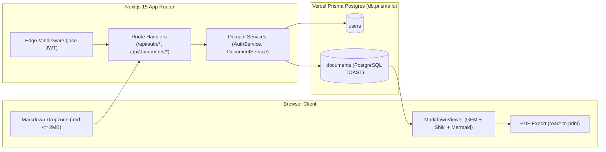

# DocuMark (.md)

DocuMark is a fullstack Next.js application that converts raw Markdown (`.md`, `.markdown`) files into formatted technical specifications, compiles fenced Mermaid.js diagrams into inline SVG flowcharts, highlights code blocks via Shiki, persists upload history in Vercel Prisma Postgres (`db.prisma.io`), and exports high-contrast A4 PDFs.

---

## System Architecture



---

## Core Capabilities

* **JWT Authentication (`jose` + `bcryptjs`):** Password hashing with 12-round bcrypt salt and stateless HS256 JWT sessions stored in `HttpOnly`, `SameSite=Lax` cookies verified at the Edge (`src/middleware.ts`).
* **Strict UTF-8 & Binary Guard (`src/lib/validations/document.schema.ts`):** Accepts `.md` and `.markdown` files up to 2 MB, rejects spoofed binary files containing null bytes (`\0`), and validates fatal UTF-8 decoding before inserting into PostgreSQL.
* **PostgreSQL TOAST Storage & Metadata-Only History (`src/services/document.service.ts`):** Persists Markdown text directly inside PostgreSQL `TEXT` columns. History list queries exclude `raw_content` so PostgreSQL avoids decompressing large text bodies until a single document is opened.
* **Sanitized GFM, Shiki & Mermaid Pipeline (`src/components/reader/markdown-viewer.tsx`):** Runs `remark-gfm` and `rehype-sanitize` with a custom schema permitting `language-*` classes before delegating fenced `mermaid` blocks to `<MermaidDiagram />` and code snippets to `<CodeBlock />`.
* **Print-Calibrated PDF Export (`src/components/reader/document-reader-workspace.tsx`):** Uses `react-to-print` (`onBeforePrint` / `onAfterPrint`) to temporarily switch Dark Mode documents and Mermaid SVGs to high-contrast light mode during print capture, preventing invisible dark-mode diagrams on white PDF pages.

---

## Tech Stack

| Layer | Technology |
| :--- | :--- |
| **Runtime & Package Manager** | Bun (`1.2.17+`) |
| **Framework** | Next.js 15 (App Router, TypeScript) |
| **Database & ORM** | Vercel Prisma Postgres (`db.prisma.io`) + Prisma ORM v6 (`@prisma/client`) |
| **Authentication** | `jose` (Edge-compatible JWT) + `bcryptjs` |
| **Markdown & Diagrams** | `react-markdown`, `remark-gfm`, `rehype-sanitize`, `shiki`, `mermaid` |
| **PDF Export** | `react-to-print` v3 + `@media print` A4 rules |
| **Styling** | Tailwind CSS v4 (`@tailwindcss/postcss`) + Custom CSS Theme Variables |

---

## Project Structure

```text
.
├── .github/workflows/ci.yml       # GitHub Actions CI/CD pipeline (Bun + Prisma + Next.js)
├── prisma/
│   ├── migrations/                # SQL migration history for users & documents tables
│   └── schema.prisma              # Prisma v6 schema wired to PRISMA_DATABASE_URL & POSTGRES_URL
├── scripts/
│   └── vercel-build.mjs           # Build script gating prisma migrate deploy by environment
├── src/
│   ├── app/
│   │   ├── (auth)/                # /login and /register pages
│   │   ├── (protected)/           # /dashboard and /read/[id] protected routes
│   │   └── api/                   # Route Handlers for /api/auth/* and /api/documents/*
│   ├── components/
│   │   ├── auth/                  # LoginForm and RegisterForm client components
│   │   ├── history/               # DocumentHistoryList with delete modal & state handling
│   │   ├── layout/                # SiteHeader with theme toggle and mobile drawer
│   │   ├── reader/                # MarkdownViewer, CodeBlock, MermaidDiagram, Workspace
│   │   ├── theme/                 # ThemeProvider (Paper Light, Carbon Dark, Print Override)
│   │   └── upload/                # MarkdownDropzone with drag-and-drop & 2MB guard
│   ├── i18n/                      # Decoupled English UI localization dictionary
│   ├── lib/                       # Prisma singleton, JWT helpers, Zod schemas, Result<T>
│   ├── services/                  # AuthService and DocumentService business logic
│   └── middleware.ts              # Next.js Edge Middleware for route protection
├── DESIGN.md                      # Visual direction, WCAG AA contrast ratios, and dials
├── .env.example                   # Template environment variables
└── package.json
```

---

## Local Setup & Development

### 1. Install Dependencies

```bash
bun install
```

### 2. Configure Environment Variables

Copy `.env.example` to `.env` and populate your Vercel Prisma Postgres connection strings and JWT secret:

```bash
cp .env.example .env
```

Required keys in `.env`:

```dotenv
DATABASE_URL="postgres://<project_id>:sk_<secret_key>@db.prisma.io:5432/postgres?sslmode=require"
POSTGRES_URL="postgres://<project_id>:sk_<secret_key>@db.prisma.io:5432/postgres?sslmode=require"
PRISMA_DATABASE_URL="postgres://<project_id>:sk_<secret_key>@db.prisma.io:5432/postgres?sslmode=require"

JWT_SECRET="<base64_32_byte_secret_from_openssl_rand_base64_32>"
```

Generate a 32-byte `JWT_SECRET` using OpenSSL:

```bash
openssl rand -base64 32
```

### 3. Generate Prisma Client & Apply Migrations

```bash
bun run db:generate
bun run db:migrate:deploy
```

For new schema changes during local development:

```bash
bun run db:migrate:dev --name <migration_name>
```

### 4. Start the Development Server

```bash
bun run dev
```

Open `http://localhost:3000` in your browser.

---

## Scripts Reference

| Command | Description |
| :--- | :--- |
| `bun run dev` | Start local Next.js development server on port 3000 |
| `bun run build` | Generate Prisma Client, conditionally deploy migrations in production, and build Next.js |
| `bun run start` | Start Next.js production server |
| `bun run typecheck` | Run TypeScript compiler check (`tsc --noEmit`) |
| `bun run db:generate` | Generate `@prisma/client` from `prisma/schema.prisma` |
| `bun run db:migrate:dev` | Create and apply a new migration during development |
| `bun run db:migrate:deploy` | Apply committed migrations in `prisma/migrations` to remote database |
| `bun run db:studio` | Launch Prisma Studio to inspect `users` and `documents` tables |

---

## Deployment (Vercel & GitHub Actions)

1. Push repository to GitHub. The workflow in `.github/workflows/ci.yml` automatically validates `prisma/schema.prisma`, runs `bun run typecheck`, and verifies `bun run build`.
2. In GitHub Repository Settings -> Secrets and variables -> Actions, add `PRISMA_DATABASE_URL` and `POSTGRES_URL` so pushes to `main` apply pending database migrations automatically.
3. Import repository into Vercel and connect your Vercel Prisma Postgres store (which injects `DATABASE_URL`, `POSTGRES_URL`, and `PRISMA_DATABASE_URL`) plus `JWT_SECRET`.
4. During production builds (`VERCEL_ENV="production"`), `scripts/vercel-build.mjs` runs `prisma generate`, `prisma migrate deploy`, and `next build`.

